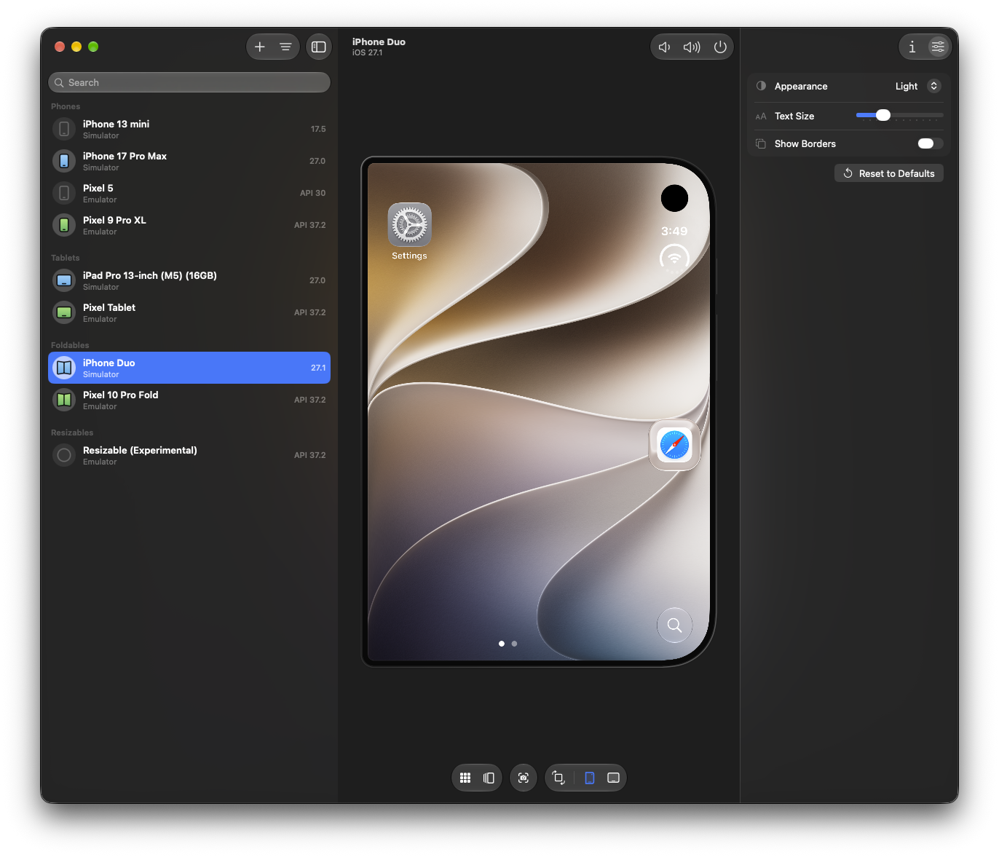
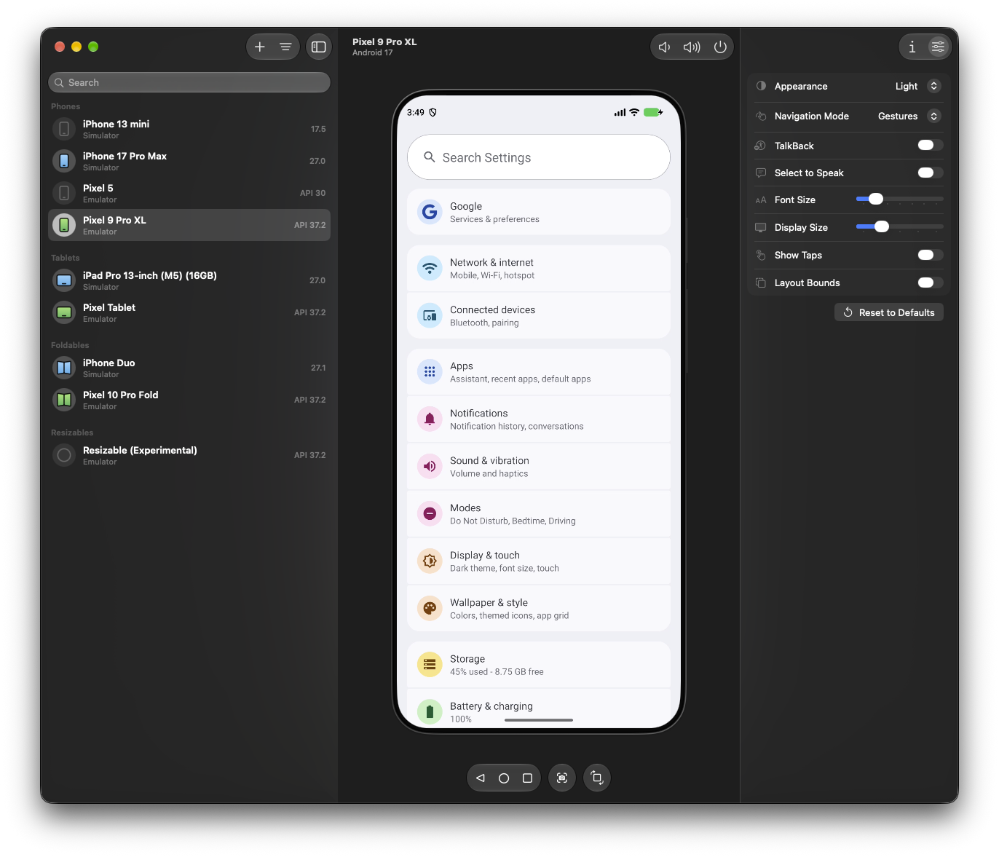

<div align="center">
  
  <h1>DevHub</h1>
  <p>Device hub for <strong>macOS</strong>, in the spirit of the Device Hub that ships with Xcode 27. Android emulators and phones, iOS simulators, and connected iPhones and iPads in one list, with the screen live and clickable inside a normal window.<br>
  Forked from <strong><a href="https://github.com/eduardoborges/droidhub">DroidHub</a></strong> by Eduardo Borges, with Apple-device support, expanded device management, and additional controls.<br>
  <strong>Tiling friendly:</strong> there's no floating toolbar and no custom chrome, so yabai and friends tile it like any other app.<br>
  Written in Swift, using <a href="https://github.com/Genymobile/scrcpy">scrcpy</a> for Android and Xcode's device frameworks for Apple devices.</p>

  [](#requirements)
  [](Sources/DevHub/)
  [](https://github.com/Genymobile/scrcpy)
  [](LICENSE)

</div>

**[Source](https://github.com/kaneoriley/devhub)** · **[Issues](https://github.com/kaneoriley/devhub/issues)**

---

<p align="center">
  <a href=".github/screenshot-apple.png"></a>
  <a href=".github/screenshot-android.png"></a>
</p>

## Why

DevHub brings Android and Apple devices into one native Mac window: virtual-device management, embedded screens, input, screenshots, file transfers, and device settings. Android Studio, Simulator.app, and DeviceHub do not need to stay open. The regular window works with tiling window managers, with no separate floating emulator toolbar to place.

## What it does

- 🪟 **A real window.** Sidebar, screen and inspector live in one window. yabai tiles it out of the box, with no rules to add.
- 📱 **Live screens with input.** Interact with Android devices and iOS simulators directly: click and drag to touch, and scroll under the pointer. Physical iPhones and iPads use Xcode's embedded screen-sharing view on supported OS versions.
- ⌨️ **Type on the device.** Use your Mac keyboard in Android apps and iOS simulators, including text, arrows, delete, accented characters, and input methods. Physical Apple devices use the input controls provided by Xcode's screen-sharing view.
- 📋 **Copy and paste.** On Android devices and iOS simulators, ⌘C, ⌘X, and ⌘A copy, cut, and select all, and ⌘V pastes text from the Mac. Android also automatically syncs text copied on the selected device back to the Mac; simulator copy and cut shortcuts retrieve its clipboard.
- 📦 **Drag-and-drop apps and files.** Install APKs (including a base APK and its splits together) on Android devices or simulator `.app` bundles on iOS simulators. Other files copy to Android's Downloads folder (`/sdcard/Download/`) or the Files app's local Downloads folder on iOS simulators. Drop apps and other files separately; Android folder drops aren't supported. Transfer progress and errors appear in the window.
- 🚀 **Manage virtual devices.** Create, boot, shut down, and delete Android emulators and iOS simulators from the device list. Choose a form factor, OS version, and compatible model when creating either kind. Virtual devices keep running when DevHub quits or restarts. Android Studio is optional; Apple simulators use your selected Xcode installation.

And the rest:

- Android has Back, Home, and Recents controls; iOS simulators have Home and App Switcher. Both have volume and power controls. Physical Apple devices use Xcode's native screen-sharing controls.
- The Info inspector shows Android and iOS simulator details, including simulator identifiers, state, runtime, and live display information. Android emulator Info also shows graphics acceleration and boot mode, with **Edit Configuration** below the details. Settings has the runtime controls supported by each platform.
- On Android devices and iOS simulators, ⌘S saves the displayed frame to the Desktop and copies it to the clipboard. A thumbnail confirmation opens the saved file in Finder. Screenshots use the mirrored display at its original resolution, including when a Resizable or foldable Android emulator changes displays.
- ⌘→ rotates Android devices and iOS simulators. Dedicated foldable emulators and foldable simulators also have Closed / Opened controls.
- Device geometry follows Android's reported per-display corner radii or Apple's simulator corner and camera masks, including after rotation, resizing, or folding. Android displays with no reported rounding keep their full rectangular image.
- Android emulators run with their own window hidden, so the embedded screen stays in DevHub. Emulators started by Android Studio or command-line tools appear here too; their Dock icon brings the original window back.
- Rotate and Phone / Foldable / Tablet share a display-control capsule. Available form factors come from the AVD's configuration and emulator; unsupported segments are disabled. Dedicated foldable emulators also get Opened / Closed controls. The selection follows the device's actual size, density, and committed folding state. DevHub boots Resizable AVDs with the emulator window hidden rather than fully headless, because resizing requires the window agent. Shut down and boot existing headless Resizable emulators once to enable switching.
- Form-factor changes finish the emulator's transition before applying the latest queued selection, and use each preset's natural orientation. Emulator rotation turns the displayed device even when Android auto-rotate is disabled or an app locks its orientation; touch input and screenshots follow the displayed rotation.
- The inspector uses an appearance picker and text-size slider on Android and Apple simulators. Android also offers Navigation Mode, TalkBack, Select to Speak, Display Size, Show Taps and Layout Bounds where supported; simulators offer Apple’s Show Borders accessibility setting when supported by Xcode. Apple’s simulator settings do not expose an equivalent to Android’s Show Taps. **Reset to Defaults** restores Android’s device-defined appearance, 100% font size, default display size and supported gesture navigation, and disables TalkBack, Select to Speak, Show Taps and Layout Bounds while preserving other accessibility services. On simulators it restores Light appearance, Large text size, and disables Show Borders.
- **Edit Configuration** in an Android emulator's Info inspector opens its saved AVD configuration, including while it is off. Configure cameras, network speed and latency, startup orientation and boot mode, internal and expanded storage, CPU cores, graphics, RAM, VM heap, and preferred application ABI. Available camera, orientation, storage, and ABI options follow the hardware profile and installed system image. Shut down a running emulator before saving. Resizing a custom SD card asks before erasing its contents. The same options are available during emulator creation.
- Physical Android devices connected through adb and physical iPhones and iPads discovered through Xcode appear in the device list alongside virtual devices.
- iOS simulators are discovered using Apple's CoreDevice inventory and appear alongside other devices under the selected filters and grouping. Unused automatic device definitions stay hidden; explicitly created simulators remain visible even before their first boot. Older toolchains fall back to CoreSimulator's default-device registry and usage metadata.
- Shut-down Apple simulators have **Delete…** in their context menu, like Android emulators. Deletion asks for confirmation and removes the virtual device and its installed apps and data. DevHub rechecks that the simulator is shut down before deleting it.
- Boot and shut down Apple simulators, interact with their embedded screens using mouse and keyboard, rotate, use Home and App Switcher, and capture screenshots. Drop simulator `.app` bundles to install them. Other files copy to **Files → Browse → On My iPhone/iPad → Downloads**, using the Files app's local-storage group; a compatible simulator Files app must be installed. Existing files are kept, with numbered names for duplicate uploads. Photos, videos, and contacts are also imported into Photos or Contacts. Install apps and copy files in separate drops. Completed transfer notifications dismiss after three seconds, pausing while hovered. On simulators, wheel or two-finger trackpad scrolling swipes under the pointer; trackpad pinch or **Option-scroll** zooms around it. Simulator displays use Apple's own corner and camera masks. The selected full Xcode installation supplies the simulator runtimes and frameworks; DeviceHub does not need to be open.
- Physical iPhones and iPads appear even when their OS does not support screen sharing. Selecting one shows any connection, trust, unlock, or compatibility requirements. On supported devices running iOS/iPadOS 27 or newer, the embedded screen-sharing view comes from the selected Xcode's DeviceKit framework. The framework stays in Xcode; DevHub does not bundle it or launch DeviceHub.
- The + menu offers **Android Emulator…** and **iOS Simulator…**. Android creation uses the bundled device catalog and installed system images; Android Studio and SDK cmdline-tools are not required. iOS creation lets you choose a name, installed OS version, and compatible iPhone or iPad model from the selected Xcode installation. New virtual devices start shut down and can be booted from the device list. Virtual devices that are off can be deleted from their context menu.
- Works alongside automation tools: watch Android sessions driven through `adb` or iOS simulators driven through Apple's simulator tools. Android's Show Taps can mark taps made by other tools too.

## Keyboard

These shortcuts apply while interacting with the embedded screen. Physical iPhones and iPads use the controls and shortcuts supplied by Xcode's native screen-sharing view.

| Key | Action | Supported devices |
|---|---|---|
| Hold ⌘, move, then click and drag | Two-finger gesture around the cursor position captured when ⌘ was pressed; release the click to lift both fingers | Android, iOS simulators |
| ⌘S | Screenshot | Android, iOS simulators |
| ⌘→ | Rotate | Android, iOS simulators |
| ⇧⌘H | Home | Android, iOS simulators |
| Esc or right click | Back | Android |
| ⌘C ⌘X ⌘A | Copy, cut, select all | Android, iOS simulators |
| ⌘V | Paste text from the Mac | Android, iOS simulators |

On iOS simulators, trackpad pinch or Option-scroll zooms around the pointer. On both platforms, wheel and two-finger trackpad scrolling act under the pointer.

## Requirements

- macOS 26+ (Liquid Glass UI)
- A full Xcode 26+ installation, selected for command-line tools in **Xcode → Settings → Locations**. The standalone Command Line Tools installation is insufficient to build the app bundle.
- For Android devices: Android SDK `platform-tools`, in `~/Library/Android/sdk` or wherever `ANDROID_HOME` points. Physical Android devices need USB debugging enabled.
- For Android emulators: SDK `emulator` tools and system images installed through `sdkmanager` or Android Studio's SDK Manager; AVDs are read from `~/.android/avd`.
- For Apple simulators: a full Xcode installation selected with `xcode-select`, with the desired simulator runtimes installed
- For physical Apple devices: a full Xcode installation selected with `xcode-select`. Devices on older iOS/iPadOS versions still appear in the list; screen sharing requires Xcode 27+ and a supported device running iOS/iPadOS 27+.

## Android device definitions

DevHub bundles Google's hardware-profile definitions, `nexus.xml` and `devices.xml`, from the Android Open Source Project's [tools/base device catalog](https://android.googlesource.com/platform/tools/base/+/mirror-goog-studio-main/sdklib/src/main/resources/com/android/sdklib/devices/). These are the definitions used by Android Studio's Device Manager. Android Studio does not need to be installed to load the catalog or create an emulator in DevHub.

The XML files are kept unmodified in [Sources/DevHub/Android/Resources](Sources/DevHub/Android/Resources). [device-catalog-NOTICE.txt](Sources/DevHub/Android/Resources/device-catalog-NOTICE.txt) records the exact upstream commit and source URL. The definitions are distributed under [Apache License 2.0](ThirdParty/android-tools-LICENSE).

To refresh the bundled snapshot from Google's Studio branch, run from the repository root:

```sh
python3 scripts/update_device_catalog.py
swift test
./build.sh
```

The script resolves the branch to a commit, downloads and validates both catalogs, then updates the XML files, license, and provenance notice. Review and commit those changes together. To reproduce a specific snapshot, pass its commit hash with `--revision <commit>`; the notice includes the complete command for the bundled version.

Hardware profiles describe the virtual device; Android SDK tools and system images are installed separately. Updating this catalog does not download system images or alter existing AVDs.

## 🛠 Build locally

DevHub must be built locally from source. The build script uses **ad hoc signing only**, for local use; it does not require a signing certificate or Apple Developer membership.

Install and open Xcode once to finish its component setup, then select it for command-line tools as described above. Clone this repository and build:

```sh
git clone https://github.com/kaneoriley/devhub.git
cd devhub
./build.sh
open build/DevHub.app
```

`build.sh` downloads the pinned Android scrcpy server into `.build/` if missing, compiles an optimized executable and resources with SwiftPM, compiles the app icon, and creates `build/DevHub.app`. It signs that bundle with `codesign --force --sign -`. Use this script to create the runnable app bundle; `swift build` alone only compiles the Swift package.

For an Xcode installation outside the selected command-line tools location, set `DEVELOPER_DIR` when building:

```sh
DEVELOPER_DIR="/path/to/Xcode.app/Contents/Developer" ./build.sh
```

To rebuild manually, quit DevHub, run `./build.sh` again, and reopen `build/DevHub.app`.

### Install and upgrade from DevHub

Open **DevHub → Check for Updates…** to view the source directory embedded by `build.sh`, choose an Applications directory (default: `~/Applications`), and install or upgrade the app there. The status compares the installed build's commit and source hash with the local Git checkout, including uncommitted changes and new files. Installed and checkout commits and hashes are shown separately, with modified working trees marked, so you can distinguish local edits from a different commit.

Opening the dialog or clicking **Check Again** fetches the current branch's configured upstream and reports new remote commits. If the branch is behind or has diverged, a notice asks you to update or reconcile it using Git before upgrading DevHub. Fetching leaves your checked-out branch, index, and working files unchanged; DevHub does not pull, merge, rebase, or switch branches. Missing upstream configuration and network or authentication failures are shown in the dialog, and local builds remain available.

DevHub also checks in the background at startup and when it returns from the background, and prompts if the running app differs from the local source or the upstream has newer commits. Dismissing a notice suppresses it for the same changes during that app session; new changes can prompt again. The prompt lists commit subjects and hashes missing from the running build in a scrollable area, including local and fetched upstream commits. Long histories show the latest 100 commits. Disable **Show update prompts** in the update dialog to skip automatic checks and prompts. Manual checks still work.

**Install** builds a missing installation; **Upgrade** rebuilds an existing installation when its commit or source hash differs, or its build identity is unknown. A progress dialog shows build, packaging, signing, and installation steps. The app verifies the staged ad hoc signed bundle, quits, replaces the installation, and relaunches from the chosen Applications directory. Build failures leave the existing installation running. Keep the source checkout at its embedded path; if you move it, build and open DevHub once from its new location.

Run the test suite:

```sh
swift test
```

For upstream source locations, compatibility rules, and maintenance verification, see [docs/](docs/README.md).

## How it works

For Android emulators and physical Android devices, DevHub pushes `scrcpy-server` to `/data/local/tmp`, opens an `adb forward` tunnel and starts the server with `app_process`. Two sockets come back. The video socket carries H.264 packets, which go into an `AVSampleBufferDisplayLayer`. The control socket carries touches, keys, text and clipboard in scrcpy's binary format, both ways.

DevHub retains the 12 most recently selected Android connections, so switching back reuses the server, tunnel, and decoder. Offscreen Android sessions drain compressed packets without decoding frames; switching back requests a fresh capture/keyframe over the existing control connection. Only the selected Android device can update the Mac clipboard. Disconnecting a device or evicting an older session closes its server and tunnel.

iOS simulators connect directly through CoreSimulator and SimulatorKit from the selected Xcode installation. DevHub renders their shared-memory display frames and forwards mouse and keyboard input through Apple's simulator APIs. Simulator sessions use a separate cache of 12 connections and pause offscreen rendering. Simulator.app and DeviceHub do not need to be open.

Physical iPhones and iPads use an embedded screen-sharing view supplied by Xcode's DeviceKit framework, including Apple's pairing, unlock and compatibility handling. Screen sharing requires iOS/iPadOS 27 or newer. These Apple frameworks are loaded from the selected Xcode installation and are not bundled with DevHub.

The Android scrcpy server version is pinned in `build.sh`. The protocol changes between releases and the server refuses a client from a different version, so bump both together.

## License

MIT, see [LICENSE](LICENSE).

The scrcpy server that `build.sh` downloads and bundles is Apache 2.0, by Genymobile. The bugdroid in the icon is based on the Android robot, created and shared by Google under the [Creative Commons Attribution 3.0 License](https://creativecommons.org/licenses/by/3.0/).
